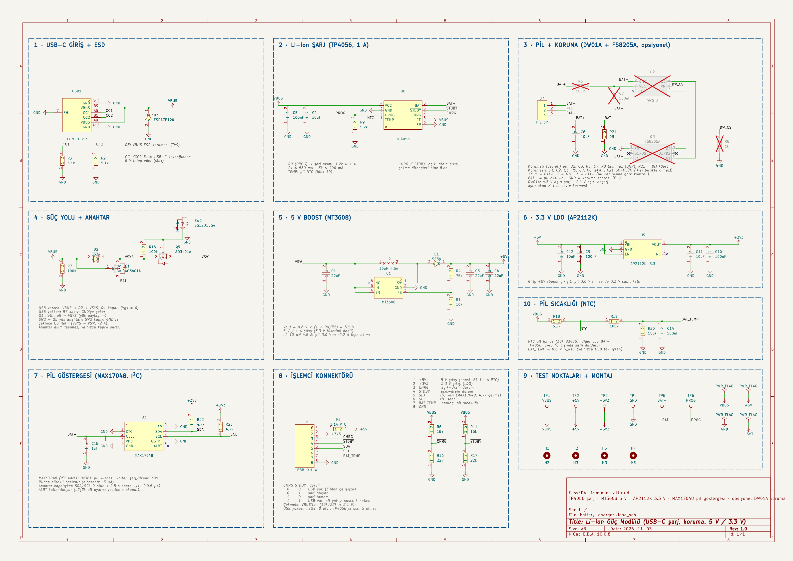

<h1 align="center">KiCad AI Battery Charger</h1>

<p align="center"><b>English</b> · <a href="README.tr.md">Türkçe</a></p>

<p align="center">
A single-cell Li-ion power module, <b>USB-C charging, battery protection, 5 V / 3.3 V outputs and
battery telemetry</b>, whose schematic was drawn in <b>KiCad 10 by an AI assistant</b>.
</p>



> **Status:** schematic complete. ERC is clean and every connection was checked automatically against
> the reference design. PCB layout has not started yet, and **the design has not been tested on
> hardware yet**.

## About the project

The circuit started as a hand-drawn EasyEDA design. An AI assistant
([Claude Code](https://claude.com/claude-code)) did the following:

- reviewed the design and suggested improvements, which were discussed and applied;
- found every part on LCSC and imported the symbols, footprints and 3D models with the
  [LCSC Part Importer](https://github.com/recepuysal/kicad-lcsc-importer) KiCad plugin;
- generated the KiCad schematic as code (see [`scripts/`](scripts));
- verified the result: `kicad-cli` ERC, plus a check that compares the netlist pin-by-pin with the
  intended connections.

The schematic notes are written in Turkish.

## Features

| | |
|---|---|
| **Input** | USB-C (5.1 kΩ CC pull-downs, works with any USB-C charger), ESD protection |
| **Charging** | TP4056, **1 A**, 4.2 V; charging stops outside 0–45 °C (battery NTC) |
| **Protection** | Optional DW01A + FS8205A (over-charge 4.3 V, over-discharge 2.4 V, over-current / short), not fitted by default, see below |
| **Output fuse** | 1.1 A resettable PTC (F1) on the connector's 5 V pin |
| **Power path** | Load sharing: runs from USB when plugged in, switches to the battery seamlessly |
| **On/off** | Slide switch drives a P-MOSFET load switch, so the switch carries no load current |
| **5 V output** | MT3608 boost, **up to 1 A**, stays at 5 V down to a 3.0 V battery |
| **3.3 V output** | AP2112K LDO fed from 5 V, stays at 3.3 V for the whole battery range |
| **Fuel gauge** | MAX17048 over I²C: state of charge (%), cell voltage, charge/discharge rate |
| **Telemetry** | Charge state, USB present, battery temperature |

## Blocks

1. USB-C input + ESD
2. Li-ion charger (TP4056)
3. Battery connector + protection (DW01A + FS8205A)
4. Power path + load switch
5. 5 V boost (MT3608)
6. 3.3 V LDO (AP2112K)
7. Fuel gauge (MAX17048)
8. MCU connector
9. Test points + mounting holes
10. Battery temperature (NTC)

## MCU connector (J1, JST-XH 8-pin)

| Pin | Signal | Description |
|---|---|---|
| 1 | +5V | 5 V output (boost, through the 1.1 A PTC fuse F1) |
| 2 | +3V3 | 3.3 V output (LDO) |
| 3 | ~CHRG | Charge status, see table below |
| 4 | ~STDBY | Charge status, see table below |
| 5 | SDA | I²C data, MAX17048 at address 0x36 (4.7 k pull-up to 3.3 V on board) |
| 6 | SCL | I²C clock |
| 7 | BAT_TEMP | Analog, 0.6 × NTC node voltage (valid while USB is plugged in) |
| 8 | GND | |

The ~CHRG / ~STDBY pull-ups are powered from USB (≈ 3.1 V), so the two lines also tell you
whether USB is present:

| ~CHRG | ~STDBY | State |
|---|---|---|
| 0 | 0 | No USB, running from battery |
| 0 | 1 | Charging |
| 1 | 0 | Charge complete |
| 1 | 1 | USB present, no battery or temperature fault |

## Battery connector (J7, JST-XH 3-pin)

`1 = BAT+`, `2 = NTC (10 k, B3435)`, `3 = BAT−`. Pin order differs between battery packs, so
**check yours before plugging it in.**

### On-board battery protection (optional)

The design targets packs with their own protection circuit, so the on-board protection is marked
**DNP** (do not populate) and the 0 Ω resistor R21 bridges BAT− to GND.

| Battery | Fit | Do not fit |
|---|---|---|
| Protected pack (default) | R21 (0 Ω) | U2, Q3, R5, C7, R8 |
| Bare cell, no protection | U2, Q3, R5, C7, R8 | **R21** (never fit both) |

## Usage notes

- Use a **5 V / 2 A or better** USB-C charger (3 A recommended). Charging at 1 A while the outputs
  are loaded needs up to ~2 A.
- At 1 A on the 5 V rail the battery delivers up to ~2.2 A near empty. The pack's own protection
  must allow **≥ 2.5 A continuous discharge**.
- The TP4056 dissipates ~1.3 W at 1 A, so give it a generous copper pour with thermal vias.
- To change the charge current, change R9 (PROG): 1.2 k ≈ 1 A, 2 k ≈ 580 mA, 3 k ≈ 400 mA.
- The MAX17048 runs from the battery all the time (~3 µA). With the power switch off the I²C
  pull-ups lose power, the bus sits low and the gauge enters sleep after 2.5 s (~0.5 µA). It does
  not track charge while asleep, so after charging with the switch off the reported % catches up
  over the next minutes.
- Do not enable the MCU's internal pull-ups on ~CHRG / ~STDBY; the board already has them.
- Firmware should shut the system down at about 3.3 V cell voltage (read from the MAX17048). The
  battery's own cutoff is much lower and repeated deep discharge ages the cell.

## Repository layout

```
hardware/                 KiCad 10 project. Open battery-charger.kicad_pro
  lib/                    project-local library: symbols, footprints, 3D models
  bom.csv                 bill of materials with LCSC part numbers
docs/                     schematic as PDF and PNG
scripts/                  Python code that generated the schematic + netlist checker
```

All parts come from the project-local `BatteryCharger` library, so the project opens complete on
any computer. No global library setup is needed.

## Regenerating the schematic

`scripts/build_project.py` regenerates the schematic and the project library. It uses the
`lcsc_importer` package from [kicad-lcsc-importer](https://github.com/recepuysal/kicad-lcsc-importer)
with parts imported into its LCSC library. Once the schematic has been edited by hand in KiCad, the
KiCad files are the source of truth and the scripts are kept for reference only.

```
python scripts/build_project.py <kicad-lcsc-importer>/plugin . scripts
kicad-cli sch export netlist --format kicadxml hardware/battery-charger.kicad_sch -o net.xml
python scripts/verify_netlist.py net.xml
```

## License

MIT
