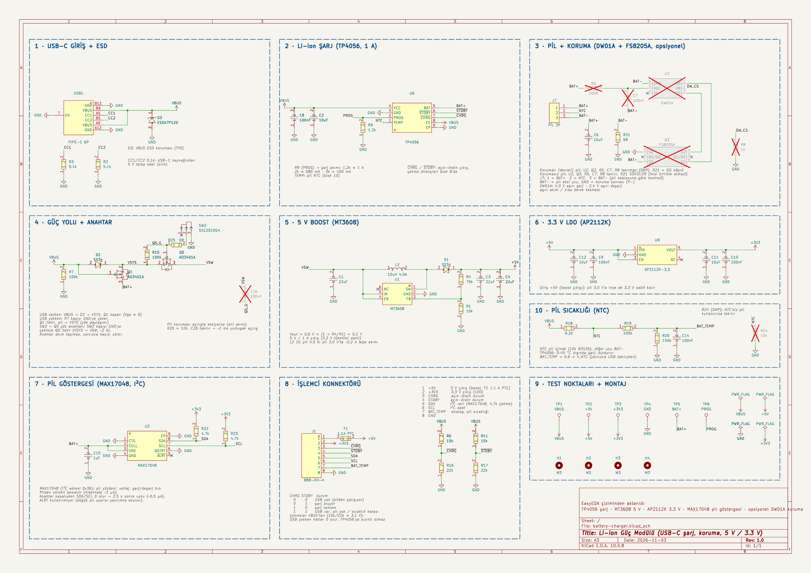

<h1 align="center">KiCad AI Battery Charger</h1>

<p align="center"><a href="README.md">English</a> · <b>Türkçe</b></p>

<p align="center">
Şeması <b>KiCad 10'da bir yapay zekâ asistanı tarafından çizilen</b>, tek hücreli Li-ion güç modülü:
<b>USB-C şarj, pil koruması, 5 V / 3.3 V çıkış ve pil bilgilerinin işlemciye aktarılması</b>.
</p>



> **Durum:** Şema tamamlandı. ERC temiz ve tüm bağlantılar hedeflenen bağlantı listesiyle
> ([`scripts/verify_netlist.py`](scripts/verify_netlist.py)) otomatik olarak karşılaştırıldı. Bu
> kontrol şemanın amaca uygun çizildiğini gösterir, amacın kendisinin doğru olduğunu kanıtlamaz.
> PCB çizimine henüz başlanmadı ve **tasarım henüz donanım üzerinde test edilmedi**.

## Proje hakkında

Devre önce EasyEDA'da elle çizildi. Ardından bir yapay zekâ asistanı
([Claude Code](https://claude.com/claude-code)) şunları yaptı:

- tasarımı inceleyip iyileştirmeler önerdi; öneriler konuşuldu ve uygulandı;
- tüm parçaları LCSC'de bulup sembol, footprint ve 3B modellerini
  [LCSC Parça Ekle](https://github.com/recepuysal/kicad-lcsc-importer) KiCad eklentisiyle ekledi;
- KiCad şemasını kodla üretti (bkz. [`scripts/`](scripts));
- sonucu doğruladı: `kicad-cli` ile ERC ve netlist'i hedeflenen bağlantılarla pin pin karşılaştıran
  bir kontrol.

## Özellikler

| | |
|---|---|
| **Giriş** | USB-C (5.1 kΩ CC dirençleri, her USB-C şarj aletiyle çalışır), ESD koruması |
| **Şarj** | TP4056, **1 A**, 4.2 V; 0–45 °C dışında şarj durur (pil NTC'si) |
| **Koruma** | Opsiyonel DW01A + FS8205A (aşırı şarj 4.3 V, aşırı deşarj 2.4 V, aşırı akım / kısa devre); varsayılan olarak takılmaz, aşağıya bakın |
| **Çıkış sigortası** | Konnektörün 5 V pininde 1.1 A kendini sıfırlayan PTC (F1) |
| **Güç yolu** | Yük paylaşımı: USB takılıyken USB'den çalışır, USB çekilince kesintisiz pile geçer |
| **Aç/kapa** | Sürgü anahtar bir P-MOSFET yük anahtarını sürer; anahtardan yük akımı geçmez |
| **5 V çıkış** | MT3608 boost, **1 A'e kadar**, pil 3.0 V'a inse de 5 V kalır |
| **3.3 V çıkış** | 5 V'tan beslenen AP2112K LDO, pilin tüm aralığında 3.3 V kalır |
| **Pil göstergesi** | I²C üzerinden MAX17048: doluluk (%), hücre voltajı, şarj/deşarj hızı |
| **Telemetri** | Şarj durumu, USB takılı mı, pil sıcaklığı |

## Bloklar

1. USB-C giriş + ESD
2. Li-ion şarj (TP4056)
3. Pil konnektörü + koruma (DW01A + FS8205A)
4. Güç yolu + yük anahtarı
5. 5 V boost (MT3608)
6. 3.3 V LDO (AP2112K)
7. Pil göstergesi (MAX17048)
8. İşlemci konnektörü
9. Test noktaları + montaj delikleri
10. Pil sıcaklığı (NTC)

## İşlemci konnektörü (J1, JST-XH 8 pin)

| Pin | Sinyal | Açıklama |
|---|---|---|
| 1 | +5V | 5 V çıkış (boost, 1.1 A PTC sigorta F1 üzerinden) |
| 2 | +3V3 | 3.3 V çıkış (LDO) |
| 3 | ~CHRG | Şarj durumu, aşağıdaki tabloya bakın |
| 4 | ~STDBY | Şarj durumu, aşağıdaki tabloya bakın |
| 5 | SDA | I²C veri, MAX17048 adresi 0x36 (kartta 3.3 V'a 4.7 k çekme) |
| 6 | SCL | I²C saat |
| 7 | BAT_TEMP | Analog, 0.6 × NTC gerilimi (USB takılıyken geçerli) |
| 8 | GND | |

~CHRG / ~STDBY çekme dirençleri USB'den beslenir (≈ 3.1 V). Böylece bu iki hat USB'nin takılı olup
olmadığını da söyler:

| ~CHRG | ~STDBY | Durum |
|---|---|---|
| 0 | 0 | USB yok, pilden çalışıyor |
| 0 | 1 | Şarj oluyor |
| 1 | 0 | Şarj tamam |
| 1 | 1 | USB var, pil yok ya da sıcaklık hatası |

## Pil konnektörü (J7, JST-XH 3 pin)

`1 = BAT+`, `2 = NTC (10 k, B3435)`, `3 = BAT−`. Pin sırası pil paketine göre değişir;
**takmadan önce kendi pilinizle karşılaştırın.**

**NTC'siz pil (2 kablolu):** R24'ü (10 k, varsayılan olarak takılmaz) takın. Takılmazsa TP4056'nın
TEMP pini VBUS'a çekilir, bunu sıcaklık hatası sayar ve **şarj hiç başlamaz**. R24 takılınca
sıcaklık kesmesi devre dışı kalır ve BAT_TEMP anlamsızlaşır.

### Kart üstü pil koruması (opsiyonel)

Tasarım kendi koruma devresi olan (devreli) piller için yapıldı. Kart üstündeki koruma **DNP**
(takılmaz) olarak işaretli; BAT− ile GND arasını 0 Ω'luk R21 köprüler.

| Pil | Takılır | Takılmaz |
|---|---|---|
| Korumalı pil (varsayılan) | R21 (0 Ω) | U2, Q3, R5, C7, R8 |
| Korumasız çıplak hücre | U2, Q3, R5, C7, R8 | **R21** (ikisi asla birlikte takılmaz) |

### Yük anahtarı yumuşak açılış (opsiyonel)

Sürgü anahtar Q5'i neredeyse anında açar. Boost giriş ve çıkışındaki ~66 µF kısa ve yüksek bir akım
darbesiyle dolar. Bazı pil koruma devreleri bunu kısa devre sanıp keser. Varsayılan olarak
R25 = 0 Ω ve C16 takılmaz, yani Q5 eskisi gibi çalışır. Pil açılışta kesiyorsa:

| | R25 | C16 (kapı – VSW) |
|---|---|---|
| Varsayılan | 0 Ω | takılmaz |
| Yumuşak açılış | 10 k | 100 nF |

Yumuşak açılışta VSW yaklaşık 2 ms'de yükselir. Bedeli: kapanış da ~20 ms'ye uzar (ağır yük
altında kapatırken Q5 kısa süre ısınır) ve Q5'in kapı gerilimi pil geriliminin ~%90'ına düşer.

## Kullanım notları

- En az **5 V / 2 A** USB-C şarj aleti kullanın (3 A önerilir). Çıkışlar yükteyken 1 A şarj
  ~2 A'e kadar çekebilir.
- 5 V hattından 1 A çekilirken pil boşalmaya yakınken ~2.2 A verir. Pilin kendi koruması
  **≥ 2.5 A sürekli deşarja** izin vermelidir.
- TP4056 1 A'de, pil 3.7 V'tayken ~1.3 W, pil boşken (3.0 V) ~2 W'a kadar ısı yayar. Altına geniş
  bakır alan ve ısı viaları koyun; ısınınca kendi ısıl regülasyonu şarj akımını düşürür.
- F1'in tutma akımı ısındıkça düşer (50 °C'de ~%20 daha az). Sıcak bir kutuda sürekli 1 A
  çekilirse atabilir; bu önemliyse daha yüksek değerli bir PTC kullanın.
- Şarj akımını değiştirmek için R9 (PROG) değiştirilir: 1.2 k ≈ 1 A, 2 k ≈ 580 mA, 3 k ≈ 400 mA.
- MAX17048 sürekli pilden beslenir (~3 µA). Güç anahtarı kapalıyken I²C çekme dirençlerinin
  beslemesi kesilir, hat 0'da kalır ve entegre 2.5 s sonra uykuya geçer (~0.5 µA). Uykudayken
  şarjı takip etmez; anahtar kapalıyken şarj edildiyse yüzde değeri açıldıktan sonraki
  dakikalarda kendini düzeltir.
- ~CHRG / ~STDBY için işlemcinin dahili çekme dirençlerini açmayın; kartta zaten var.
- USB takılı ve anahtar kapalıyken ~CHRG / ~STDBY ~3 V'ta kalır ve beslemesiz işlemciyi pin koruma
  diyotları üzerinden besleyebilir (15 k üzerinden, 1 mA'in çok altında).
- BAT_TEMP, VBUS ile orantılıdır; şarj aletinin ±%5 gerilim toleransı birkaç °C hata olarak
  yansır. Çıkış empedansı yüksektir (~60 k); ADC örnekleme süresini uzun tutun.
- USB takılı değilken Q1 hep iletimdedir; D2'nin (SS34) ters sızıntısı anahtar kapalıyken de pili
  boşaltır: oda sıcaklığında µA'ler, sıcakta çok daha fazla. İlk kartta kapalı akımını ölçün.
- Yazılım, hücre gerilimi ~3.3 V'a düştüğünde (MAX17048'den okunur) sistemi kapatmalıdır. Pilin
  kendi kesmesi çok daha düşüktür ve sık derin deşarj pili yıpratır.

## Klasör yapısı

```
hardware/                 KiCad 10 projesi; battery-charger.kicad_pro dosyasını açın
  lib/                    projeye özel kütüphane: sembol, footprint, 3B model
  bom.csv                 LCSC kodlarıyla malzeme listesi
docs/                     şemanın PDF ve PNG hâli
scripts/                  şemayı üreten Python kodu + netlist doğrulayıcı
```

Tüm parçalar projeye özel `BatteryCharger` kütüphanesinden gelir. Proje başka bir bilgisayarda da
eksiksiz açılır; genel kütüphane ayarı gerekmez.

## Şemayı yeniden üretmek

`scripts/build_project.py` şemayı ve proje kütüphanesini yeniden üretir.
[kicad-lcsc-importer](https://github.com/recepuysal/kicad-lcsc-importer) içindeki `lcsc_importer`
paketini ve onun LCSC kütüphanesine eklenmiş parçaları kullanır. Şema KiCad'de elle düzenlendikten
sonra esas kaynak KiCad dosyalarıdır; betikler yalnızca referans olarak durur.

## Lisans

MIT
